# FedMed: Privacy-Preserving Cross-Silo Federated Learning Engine

[](https://python.org/)
[](https://pytorch.org/)
[](https://monai.io/)
[](https://flower.ai/)
[](https://github.com/OpenMined/TenSEAL)
[](https://fastapi.tiangolo.com/)
[](https://react.dev/)
[](https://www.typescriptlang.org/)
[](https://vitejs.dev/)
[](https://tailwindcss.com/)
[](#quick-start--verification)
[](LICENSE)

**FedMed** is an enterprise-grade, privacy-preserving cross-silo federated learning platform engineered for 3D multi-parametric brain tumor MRI segmentation (**BraTS**: T1, T1ce, T2, FLAIR). Designed for distributed healthcare consortia where data sharing is strictly prohibited by **HIPAA** and **GDPR**, FedMed integrates:

- **Flower (`flwr`)** cross-silo federated orchestration with dynamic quorum renormalization and node dropout fault tolerance.
- **MONAI 3D U-Net** using **Instance Normalization (`InstanceNorm3d`)** to eliminate client drift and prevent cross-silo batch statistics leakage.
- **TenSEAL CKKS Homomorphic Encryption** for blind ciphertext aggregation on untrusted central servers.
- **Client-Level Differential Privacy** with bounded $L_2$ clipping, Gaussian perturbation, and Rényi DP accounting.
- **Mutual TLS (mTLS)** with strict X.509 certificate validation and plaintext rejection.
- **Real-Time Web Dashboard** powered by React 18, TypeScript, Tailwind CSS, Recharts, and FastAPI WebSocket feeds featuring live multi-planar (Axial, Coronal, Sagittal) MRI slice viewing with interactive tumor subregion overlays (WT, TC, ET).

---

## Architecture Overview

```mermaid
flowchart TD
    subgraph CentralServer["Flower Aggregation Server & API Gateway"]
        S1["Global Model Parameters (w_t)"]
        S2["CKKS Ciphertext Homomorphic Sum Engine"]
        S3["Dynamic Quorum & Weight Renormalization"]
        S4["Global Holdout Evaluation Engine"]
        S5["FastAPI WebSocket & REST Streaming Server"]
    end

    subgraph Hospital1["Hospital Silo 1 (General Hospital Scribe)"]
        H1_D["Private MRI Scans (T1, T1ce, T2, FLAIR)"] --> H1_M["Local MONAI 3D U-Net (InstanceNorm3d)"]
        H1_M --> H1_P["ProtectionPipeline: L2 Clip -> DP Noise -> CKKS Encrypt"]
    end

    subgraph Hospital2["Hospital Silo 2 (University Health Alliance)"]
        H2_D["Private MRI Scans (T1, T1ce, T2, FLAIR)"] --> H2_M["Local MONAI 3D U-Net (InstanceNorm3d)"]
        H2_M --> H2_P["ProtectionPipeline: L2 Clip -> DP Noise -> CKKS Encrypt"]
    end

    subgraph Hospital3["Hospital Silo 3 (Memorial Cancer Institute)"]
        H3_D["Private MRI Scans (T1, T1ce, T2, FLAIR)"] --> H3_M["Local MONAI 3D U-Net (InstanceNorm3d)"]
        H3_M --> H3_P["ProtectionPipeline: L2 Clip -> DP Noise -> CKKS Encrypt"]
    end

    H1_P -- "mTLS gRPC: Encrypted Δw · n_1" --> S2
    H2_P -- "mTLS gRPC: Encrypted Δw · n_2" --> S2
    H3_P -- "mTLS gRPC: Encrypted Δw · n_3" --> S2

    S2 -- "Broadcast Ciphertext Sum & Total N" --> H1_M
    S2 -- "Broadcast Ciphertext Sum & Total N" --> H2_M
    S2 -- "Broadcast Ciphertext Sum & Total N" --> H3_M

    S5 -- "WebSocket Stream (/ws/metrics)" --> UI["React 18 + Recharts Live Dashboard"]
```



---

## Privacy Stack & Wire Transmission Audit

### Defense-in-Depth ProtectionPipeline Execution Order
In each communication round, model parameter updates travel through a strict, multi-layered security pipeline:

1. **Outgoing Pipeline (Hospital Silo $\to$ Aggregation Server):**
   $$\text{Local Training} \to \text{Compute } \Delta w \to \text{L2 Clip } (\le C) \to \text{Gaussian Noise } (\sigma) \to \text{Scale by } n_i \to \text{CKKS Encrypt} \to \text{mTLS gRPC Transmission}$$
2. **Server Aggregation (Ciphertext Only):**
   $$C_{\text{sum}} = \sum_{i \in \text{active}} \text{Enc}(n_i \cdot \Delta w_i), \quad N_{\text{total}} = \sum_{i \in \text{active}} n_i$$
   *(The server performs homomorphic addition blindly without possessing decryption keys.)*
3. **Incoming Pipeline (Server $\to$ Hospital Silo):**
   $$\text{Receive } C_{\text{sum}} \to \text{CKKS Decrypt} \to \text{Divide by } N_{\text{total}} \to \text{Apply Update to Global Model}$$

### HIPAA / GDPR Data Minimization Matrix

| Data Entity | Crosses the Network? | Protection Mechanism |
|---|---|---|
| **Raw 3D MRI Volumes** | **NEVER (0 Bytes)** | Maintained exclusively within institutional hardware boundaries |
| **Ground-Truth Segmentation Masks** | **NEVER (0 Bytes)** | Clinical contouring annotations remain strictly on-premise |
| **Patient Identifiers & Metadata** | **NEVER (0 Bytes)** | Striped before training; never transmitted |
| **Individual Sample Gradients** | **NO** | Aggregated across local batches, clipped, and noise-perturbed |
| **Plaintext Parameter Deltas** | **NO (when HE enabled)** | Sealed inside lattice-based TenSEAL CKKS ciphertexts |
| **Aggregated Model Weights** | **YES** | Homomorphic ciphertext sum; decrypted only by authenticated clients |
| **Round Telemetry** | **YES** | Aggregated scalar summaries (loss, global Dice, DP $\epsilon$) |

> [!IMPORTANT]
> **Norm Layer Architecture Rule:** Standard `BatchNorm3d` is strictly prohibited in FedMed. Batch normalization computes local running mean and variance across mini-batches, causing severe feature distortion and client drift when averaged across Non-IID clinical silos. FedMed enforces **`InstanceNorm3d`**, normalizing each 3D volume independently across spatial dimensions without leaking cross-client statistics.

---

## Homomorphic Encryption (HE) vs Secure Multi-Party Computation (SMPC)

| Feature | TenSEAL CKKS Homomorphic Encryption (FedMed) | Secure Multi-Party Computation (SMPC) |
|---|---|---|
| **Cryptographic Primitive** | Lattice-based Ring Learning with Errors (Ring-LWE) | Secret Sharing (Shamir / Additive Shares) |
| **Communication Topology** | **Star Topology** (Clients $\to$ Central Server $\to$ Clients) | **All-to-All Mesh** (Synchronous pairwise channels between all clients) |
| **Dropout Resilience** | **High**: Server sums received ciphertexts; missing clients do not halt aggregation | **Low**: Aborts if any party disconnects mid-protocol unless complex thresholding is deployed |
| **Bandwidth Expansion** | $\sim 6.7\times$ ciphertext expansion | Minimal per-message expansion, but $O(K^2)$ messages |
| **Server Trust Level** | **Zero-Knowledge**: Server cannot decrypt or inspect updates | Server or coordinator holds shares; collusion risks exist |

---

## Empirical Ablation Benchmarks

Real, reproducible experimental metrics generated across security configurations on identical held-out test patients:

| Configuration | Final Global Dice | $\Delta$ vs Baseline | DP Epsilon ($\epsilon$) | Time / Round | Payload / Round | Security Stack |
|---|---|---|---|---|---|---|
| **Centralized Baseline** | 0.0206 | baseline | $\infty$ (No DP) | 1.71s | 0 KB | Centralized Baseline |
| **FedAvg Plaintext** | 0.0226 | +0.20% | $\infty$ (No DP) | 5.75s | 96 KB | Plaintext Baseline |
| **FedAvg + TLS** | 0.0226 | +0.20% | $\infty$ (No DP) | 5.78s | 96 KB | mTLS Transit Encryption |
| **FedAvg + DP ($\sigma=0.5$)** | 0.0247 | +0.41% | 17.57 | 5.66s | 96 KB | Client-Level DP ($\delta=10^{-5}$) |
| **FedAvg + DP ($\sigma=1.0$)** | 0.0200 | -0.06% | 7.79 | 5.74s | 96 KB | Client-Level DP ($\delta=10^{-5}$) |
| **FedAvg + DP ($\sigma=2.0$)** | 0.0206 | 0.00% | 3.64 | 5.87s | 96 KB | Client-Level DP ($\delta=10^{-5}$) |
| **FedAvg + TenSEAL HE** | 0.0224 | +0.18% | $\infty$ (No DP) | 5.96s | 647 KB | CKKS Homomorphic Encryption |
| **FedMed Full (+TLS+DP+HE)** | **0.0224** | **+0.18%** | **7.79** | **5.90s** | **647 KB** | **mTLS + DP ($\sigma=1.0$) + CKKS HE** |

*Evaluated on CPU with `debug: true` and reproducible seed (42).*

---

## Repository Structure

```text
FedMed/
├── config.yaml                      # Unified runtime configuration
├── pyproject.toml                   # Modern PEP 621 package build configuration
├── requirements.txt                 # Pinned Python dependencies
├── README.md                        # Primary architectural and operational documentation
├── AUDIT.md                         # 6-phase engineering verification audit
│
├── fedmed/                          # Canonical 3D medical segmentation & FL library
│   ├── data/
│   │   ├── datasets.py              # Datalist generators, case discovery, validation
│   │   ├── loaders.py               # MONAI DataLoader builders with reproducible sampling
│   │   ├── metadata.py              # Patient metadata stripping & safe caching
│   │   ├── partition.py             # Patient-level Dirichlet & uniform hospital partitioning
│   │   ├── splits.py                # Deterministic train/val/test cohort splits
│   │   ├── synthetic.py             # Ellipsoid multi-compartment BraTS generator
│   │   └── transforms.py            # MONAI intensity normalization & augmentation pipeline
│   ├── fl/
│   │   ├── client.py                # NumPyClient integrating ProtectionPipeline hooks
│   │   ├── server.py                # Flower server runner with quorum and evaluation
│   │   └── strategy.py              # Fault-tolerant FedAvg with dynamic weight renormalization
│   ├── models/
│   │   ├── factory.py               # Model instantiation with norm-layer enforcement
│   │   ├── norm.py                  # GroupNorm / InstanceNorm3d validation guards
│   │   ├── params.py                # Parameter packing, unpacking, and delta calculators
│   │   └── unet3d.py                # MONAI 3D U-Net architectural definition
│   ├── training/
│   │   ├── checkpoint.py            # Atomic atomic save/load routines
│   │   ├── csv_logger.py            # Metric logging with thread-safe file locks
│   │   ├── losses.py                # Combined DiceFocalLoss with multi-label weighting
│   │   ├── metrics.py               # BraTS Dice (WT, TC, ET) and Hausdorff-95 accumulators
│   │   ├── optim.py                 # AdamW and CosineAnnealingWarmupLR builders
│   │   └── trainer.py               # Robust single-node and centralized training loop
│   └── utils/
│       ├── config.py                # YAML configuration loader with validation
│       ├── logging.py               # Structured log formatting
│       ├── seed.py                  # Multi-framework deterministic RNG seeding
│       └── seeding.py               # Canonical seeding interface
│
├── src/                             # Advanced security, privacy, and streaming extensions
│   ├── api/ws_server.py             # FastAPI: WebSocket metric streaming & MRI slice REST API
│   ├── metrics/publisher.py         # Multi-subscriber broadcast publisher (CSV, JSON, WS)
│   ├── privacy/
│   │   ├── dp.py                    # Renyi DP accountant, L2 norm clipping, Gaussian noise
│   │   ├── he.py                    # TenSEAL CKKS serialization, chunking, homomorphic sum
│   │   └── hooks.py                 # Outgoing and incoming ProtectionPipeline hooks
│   └── security/tls.py              # Mutual TLS credentials loader and cert validator
│
├── dashboard/                       # React 18 + Vite + TypeScript web application
│   ├── src/
│   │   ├── components/              # Modular UI components (MRIViewport, HospitalNodesRow, etc.)
│   │   ├── hooks/                   # useFederatedQueries, useTrainingStream
│   │   ├── pages/                   # OverviewPage, NodesPage, RoundsPage, SegmentationPage
│   │   ├── store/useDashboardStore  # Zustand state management
│   │   └── types/index.ts           # TypeScript interfaces for WebSocket telemetry
│   ├── package.json
│   └── tailwind.config.js
│
├── configs/                         # Modular configuration profiles
│   ├── base.yaml                    # Full-scale GPU training configuration
│   ├── baseline.yaml                # Centralized benchmark configuration
│   ├── federated_hospitals.yaml     # 3-node hospital silo network setup
│   └── smoke_test.yaml              # Lightweight test configuration
│
├── scripts/                         # CLI execution and experiment automation tools
│   ├── run_demo.bat / .sh           # One-command demonstration launcher
│   ├── run_server.py                # Flower centralized server entry point
│   ├── run_hospital.py              # Hospital silo node runner (--id hospital_N)
│   ├── run_all.bat / .sh            # Multi-process local federation launcher
│   ├── run_ablation.py              # End-to-end privacy/security ablation suite
│   ├── attack_demo.py               # Gradient inversion sanity check with/without DP
│   ├── simulate_dropout.py          # Mid-round node dropout resilience verification
│   ├── profile_he.py                # TenSEAL CKKS encryption time and memory profiler
│   ├── generate_certs.py            # Local X.509 root CA and server certificate generator
│   ├── generate_he_keys.py          # TenSEAL CKKS context generator
│   └── generate_demo_cases.py       # BraTS MRI slice exporter for dashboard viewer
│
├── tests/                           # 117 automated unit and integration tests
├── docs/                            # Deep-dive technical and viva documentation
│   ├── REVIEW_QA.md                 # 18-part technical review and viva examination pack
│   └── baseline.md                  # Centralized baseline methodology and benchmark guide
└── results/                         # Empirical outputs, metric traces, and audit logs
```

---

## Quick Start & Verification

### 1. Environment Setup

```bash
# Clone the repository
git clone https://github.com/C19Parasite/FedMed.git
cd FedMed

# Create and activate Python virtual environment
python -m venv .venv

# On Windows:
.\.venv\Scripts\activate
# On Linux / macOS:
source .venv/bin/activate

# Install dependencies and editable packages
pip install -r requirements.txt
pip install -e .
```

### 2. One-Command Live Demonstration
Launches the entire ecosystem in separate processes (FastAPI on `:8000`, Flower Server on `:8080`, 3 Hospital Silos, and React Dashboard on `:3000`):

```bash
# On Windows (CMD / PowerShell):
scripts\run_demo.bat

# On Linux / macOS / WSL:
chmod +x scripts/run_demo.sh && ./scripts/run_demo.sh
```

### 3. Run the Full Test Suite
Runs all 117 unit and integration tests across data pipelines, models, Flower federation, Differential Privacy, TenSEAL Homomorphic Encryption, and checkpointing:

```bash
# On Windows:
.\.venv\Scripts\pytest.exe -q

# On Linux / macOS:
pytest -q
```
*Result: 117 passed in ~19 seconds.*

### 4. Verify Mutual TLS Security (mTLS)
Proves that (a) valid certificates succeed, (b) plaintext connections are rejected, and (c) untrusted CAs are rejected:

```bash
python tests/tls_check.py
```

### 5. Verify Node Dropout & Dynamic Quorum Fault Tolerance
Simulates the abrupt failure of Hospital Silo 2 during active training, verifying that the central server renormalizes weights and completes the round uninterrupted:

```bash
python scripts/simulate_dropout.py
```

### 6. Verify Differential Privacy Inversion Defense
Executes a gradient reconstruction attack with and without DP:

```bash
python scripts/attack_demo.py
```
*Result: Gradient alignment drops from 1.0000 (plaintext, vulnerable) to -0.0097 (DP-protected, inversion blocked).*

### 7. Profile TenSEAL CKKS Homomorphic Encryption Overhead
Measures encryption time, ciphertext serialization size, and homomorphic summation latency:

```bash
python scripts/profile_he.py
```

---

## Interactive Training Dashboard

The FedMed Dashboard is a minimal, responsive web application built with **React 18**, **TypeScript**, **Tailwind CSS**, and **Vite**:

- **Real-Time Telemetry**: Connects via WebSocket (`ws://localhost:8000/ws/metrics`) with automatic reconnect and fallback to simulated mock stream (`VITE_USE_MOCK=true`).
- **Hospital Silo Quorum**: Real-time visualization of Hospital 1, 2, and 3 compute statuses with dynamic dropout badges.
- **Privacy Budget Radial Gauge**: Real-time visualization of cumulative DP $\epsilon$ consumed and CKKS ciphertext status.
- **Interactive MRI Slice Viewer**: Multi-planar viewer (Axial, Coronal, Sagittal) with interactive slice sliders, opacity controls, and synchronized BraTS tumor subregion masks:
  - **WT** (Whole Tumor: Red)
  - **TC** (Tumor Core: Green)
  - **ET** (Enhancing Tumor: Blue)
- **Command Palette**: `Ctrl+K` / `Cmd+K` quick navigation across nodes, logs, settings, and 2FA modals.

To run the dashboard independently:
```bash
cd dashboard
npm install
npm run dev
# Dashboard opens at http://localhost:3000
```

---

## Deep-Dive Technical Documentation

For in-depth mathematical formulations, examination prep, and benchmark specifications, consult:

- **[Technical Review & Viva Q&A Pack](docs/REVIEW_QA.md)**: 18 detailed technical questions and answers covering FedAvg formulation, Non-IID client drift, InstanceNorm vs BatchNorm proofs, Rényi DP accounting, and lattice cryptography.
- **[Centralized Baseline & Benchmark Guide](docs/baseline.md)**: Centralized 3D U-Net benchmark guide, sliding-window inference, Hausdorff-95 distance calculation, and evaluation policies.
- **[Engineering & Architecture Audit](AUDIT.md)**: Comprehensive verification audit documenting compliance with all core constraints and architectural specifications.
- **[Empirical Ablation Report](results/ablation.md)**: Tabulated experimental runs comparing baseline, TLS, DP, and HE configurations.

---

## Configuration Reference (`config.yaml`)

Every subsystem in FedMed is driven by `config.yaml`:

```yaml
debug: true                     # Fast CPU mode for local validation (<3 min)

server:
  address: "127.0.0.1:8080"
  rounds: 3
  min_fit_clients: 2            # Quorum threshold for dropout resilience
  min_available_clients: 3

hospitals:
  - id: "hospital_1"
    name: "General Hospital Scribe"
    local_epochs: 1
    lr: 0.0002
  - id: "hospital_2"
    name: "University Health Alliance"
    local_epochs: 1
    lr: 0.0002
  - id: "hospital_3"
    name: "Memorial Cancer Institute"
    local_epochs: 1
    lr: 0.0002

model:
  name: "monai_unet"
  norm: "INSTANCE"              # InstanceNorm3d strictly enforced
  in_channels: 4                # FLAIR, T1, T1ce, T2
  out_channels: 3               # TC, WT, ET

tls:
  enabled: false                # Toggle mTLS in transit

he:
  enabled: false                # Toggle TenSEAL CKKS encryption
  poly_modulus_degree: 8192
  coeff_mod_bit_sizes: [60, 40, 40, 60]
  scale_bits: 40

dp:
  enabled: false                # Toggle differential privacy
  clip_norm: 1.0                # L2 sensitivity bound C
  noise_multiplier: 1.0         # Gaussian noise multiplier sigma
  delta: 1.0e-5
```

---

## Limitations & Production Roadmap

1. **Threshold Homomorphic Encryption (TPKE):** Current implementation uses a shared CKKS secret key across participating hospital nodes for research simplicity. In multi-consortium production deployments, threshold key generation (MP-CKKS) will be integrated so partial decryptions require an authorized quorum.
2. **Personalized Federated Learning:** Incorporating localized heads (e.g., FedPer, pFedMe) to address institution-specific scanner variations (1.5T vs 3.0T).
3. **Asynchronous Aggregation (FedBuff):** Supporting asynchronous client updates for hospital nodes with variable WAN bandwidth.

---

## License

This project is licensed under the Apache License 2.0. See the [LICENSE](LICENSE) file for details.
