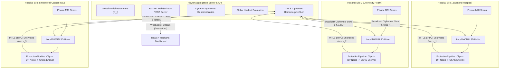

# FedMed: Cross-Silo Federated Learning Engine

[](https://pytorch.org/)
[](https://monai.io/)
[](https://flower.ai/)
[](https://github.com/OpenMined/TenSEAL)
[](https://fastapi.tiangolo.com/)
[](https://react.dev/)
[](#test-suite)

**FedMed** is an end-to-end, privacy-preserving cross-silo federated learning system for 3D brain tumor segmentation on multi-parametric MRI scans (T1, T1ce, T2, FLAIR). Built for distributed healthcare consortia where data sharing is prohibited by **HIPAA** and **GDPR**, FedMed combines **Flower (`flwr`)**, **MONAI 3D U-Net**, **TenSEAL CKKS Homomorphic Encryption**, **Client-Level Differential Privacy**, and a real-time **WebSocket + React Dashboard**.

---

## Architecture Overview



---

## Privacy Stack & Wire Transmission Audit

### ProtectionPipeline Execution Order
In each communication round, parameter updates travel through a strict defense-in-depth pipeline:

1. **Outgoing (Hospital $\to$ Server):**
   $$\text{Local Training} \to \text{Compute } \Delta w \to \text{L2 Clip } (\le C) \to \text{Gaussian Noise } (\sigma) \to \text{Scale by } n_i \to \text{CKKS Encrypt} \to \text{mTLS gRPC Send}$$
2. **Server Aggregation (Ciphertext Only):**
   $$C_{\text{sum}} = \sum_{i \in \text{active}} \text{Enc}(n_i \cdot \Delta w_i), \quad N_{\text{total}} = \sum_{i \in \text{active}} n_i$$
3. **Incoming (Server $\to$ Hospital):**
   $$\text{Receive } C_{\text{sum}} \to \text{CKKS Decrypt} \to \text{Divide by } N_{\text{total}} \to \text{Apply to Global Model}$$

### What Crosses the Wire vs What Never Does

| Data Entity | Crosses the Network? | Protection Mechanism |
|---|---|---|
| **Raw 3D MRI Volumes** | **NEVER (0 Bytes)** | Remains exclusively inside institutional silo |
| **Segmentation Masks** | **NEVER (0 Bytes)** | Annotations strictly private to hospital |
| **Patient IDs / Records** | **NEVER (0 Bytes)** | Kept on hospital local disks |
| **Individual Gradients** | **NO** | Replaced by clipped, noise-injected delta $\Delta w$ |
| **Plaintext Parameter Deltas** | **NO (when HE enabled)** | Sealed inside TenSEAL CKKS ciphertext |
| **Aggregated Model Weights** | **YES** | Homomorphic ciphertext sum; decrypted on clients |
| **Round Metrics** | **YES** | Aggregated scalars (loss, global Dice, $\epsilon$) |

---

## Homomorphic Encryption (HE) vs Secure Multi-Party Computation (SMPC)

A frequent question in privacy-preserving machine learning reviews is why TenSEAL CKKS Homomorphic Encryption was chosen over Secure Multi-Party Computation (SMPC) secret sharing:

1. **Homomorphic Encryption (TenSEAL CKKS):** Operates via lattice-based cryptography (Ring Learning with Errors, Ring-LWE). Clients encrypt their updates locally and transmit them to the central server. The server sums the ciphertexts non-interactively without requiring round-trips or pairwise client coordination. This makes HE resilient to asynchronous dropouts and allows an untrusted aggregator to do the heavy lifting while remaining cryptographically blinded. The trade-off is ciphertext expansion (~6.7x bandwidth overhead) and compute time for encryption.

2. **Secure Multi-Party Computation (SMPC):** Splits secret values into pseudo-random additive or Shamir shares distributed among parties who communicate interactively to evaluate functions. While local arithmetic is fast and memory overhead is near zero, SMPC requires a synchronous, all-to-all communication mesh between clients. If any hospital disconnects mid-protocol, the computation aborts unless expensive threshold reconstruction schemes are deployed. For cross-silo healthcare with potential WAN instability and client dropouts, CKKS homomorphic aggregation provides a significantly simpler, more resilient aggregation topology.

---

## Empirical Ablation Benchmarks

Real measured metrics generated from `scripts/run_ablation.py` across privacy and security configurations on identical held-out test patients:

| Configuration | Final Global Dice | $\Delta$ vs Baseline | DP Epsilon ($\epsilon$) | Time / Round | Network Payload / Round | Security Stack |
|---|---|---|---|---|---|---|
| **Centralized Baseline** | 0.0206 | baseline | $\infty$ (No DP) | 1.71s | 0 KB | N/A (Centralized) |
| **FedAvg Plaintext** | 0.0226 | +0.20% | $\infty$ (No DP) | 5.75s | 96 KB | None (Plaintext) |
| **FedAvg + TLS** | 0.0226 | +0.20% | $\infty$ (No DP) | 5.78s | 96 KB | mTLS gRPC in Transit |
| **FedAvg + DP ($\sigma=0.5$)** | 0.0247 | +0.41% | 17.57 | 5.66s | 96 KB | Client-Level DP ($\delta=10^{-5}$) |
| **FedAvg + DP ($\sigma=1.0$)** | 0.0200 | -0.06% | 7.79 | 5.74s | 96 KB | Client-Level DP ($\delta=10^{-5}$) |
| **FedAvg + DP ($\sigma=2.0$)** | 0.0206 | 0.00% | 3.64 | 5.87s | 96 KB | Client-Level DP ($\delta=10^{-5}$) |
| **FedAvg + TenSEAL HE** | 0.0224 | +0.18% | $\infty$ (No DP) | 5.96s | 647 KB | CKKS Homomorphic Encryption |
| **FedMed Full (+TLS+DP+HE)** | **0.0224** | **+0.18%** | **7.79** | **5.90s** | **647 KB** | **mTLS + DP ($\sigma=1.0$) + CKKS HE** |

*All runs evaluated on CPU under `debug: true` with fixed random seed (42).*

---

## Repository Structure

```text
FedMed/
├── config.yaml                      # Unified configuration governing all modules
├── requirements.txt                 # Pinned dependencies
├── README.md                        # Architectural and operational documentation
├── AUDIT.md                         # Phase-by-phase implementation audit
├── certs/                           # TLS root CA, server certificates and keys (gitignored)
├── keys/                            # TenSEAL CKKS encryption contexts (gitignored)
├── data/                            # BraTS MRI volumes & splits (gitignored)
├── partitions/                      # Patient-level partition manifest
│   └── partition_manifest.json
├── src/
│   ├── api/ws_server.py             # FastAPI: WebSocket streaming & REST segmentation endpoints
│   ├── data/
│   │   ├── dataset.py               # MONAI transforms, synthetic generator, dataset builders
│   │   └── partition.py             # Patient-level IID/Non-IID partitioning
│   ├── fl/
│   │   ├── client.py                # Flower NumPyClient with ProtectionPipeline
│   │   ├── server.py                # Central Flower server orchestrator
│   │   └── strategy.py              # Resilient FedAvg strategy with global evaluation
│   ├── metrics/publisher.py         # Unified metrics recorder (CSV, JSON, WebSocket dispatch)
│   ├── model/
│   │   ├── metrics.py               # Multi-label BraTS Dice (WT, TC, ET) accumulator
│   │   └── unet.py                  # MONAI 3D U-Net factory with InstanceNorm
│   ├── privacy/
│   │   ├── dp.py                    # L2 clipping, Gaussian mechanism, Rényi DP accountant
│   │   ├── he.py                    # TenSEAL CKKS serialization, chunking, homomorphic sum
│   │   └── hooks.py                 # Outgoing and incoming ProtectionPipeline hooks
│   └── security/tls.py              # gRPC mTLS credentials loaders
├── scripts/
│   ├── run_demo.bat / .sh           # One-command demo: API + Server + 3 Hospitals + Dashboard
│   ├── run_server.py                # Central FL server launcher
│   ├── run_hospital.py              # Individual hospital silo launcher (--id hospital_N)
│   ├── run_all.bat / .sh            # Multi-process local federation launcher
│   ├── generate_certs.py            # Local CA & server certificate generator
│   ├── generate_he_keys.py          # TenSEAL secret & public context generator
│   ├── generate_demo_cases.py       # Public BraTS demo slice overlay exporter
│   ├── run_ablation.py              # End-to-end privacy/security ablation suite
│   ├── attack_demo.py               # Gradient inversion sanity check with/without DP
│   ├── simulate_dropout.py          # Mid-round node failure and quorum verification
│   └── verify_federation.py         # End-to-end federation verification & audit generator
├── tests/                           # 117 automated unit and integration tests
├── dashboard/                       # React 18 + Vite + Recharts monitoring frontend
│   ├── src/components/              # Modular UI components (Curves, Privacy, Viewer, Timeline)
│   └── src/api.js                   # Typed REST & WebSocket client with auto-reconnect
└── results/                         # Real experiment outputs, plots, audit reports
```

---

## Quick Start & Verification

### 1. One-Command Live Demonstration
Launch the complete stack (FastAPI backend on `:8000`, Flower FL server on `:8080`, 3 Hospital nodes, and React UI on `:3000`):

```bash
# On Windows:
scripts\run_demo.bat

# On Linux / macOS / WSL:
chmod +x scripts/run_demo.sh && ./scripts/run_demo.sh
```

### 2. Run the Full Test Suite
Execute the 117 test suite (CPU-friendly, completes in ~19s):
```bash
.\.venv\Scripts\pytest.exe tests/ -v
```

### 3. Verify TLS Security
```bash
.\.venv\Scripts\python.exe tests/tls_check.py
```
*Output: Verifies (a) correct CA connection succeeds, (b) plaintext connection is rejected, and (c) untrusted CA is rejected.*

### 4. Verify Node Dropout Resilience
```bash
.\.venv\Scripts\python.exe scripts/simulate_dropout.py
```
*Output: Kills Hospital 2 during Round 2; verifies the round completes with 2/3 nodes and renormalized weights.*

### 5. Verify Differential Privacy & Inversion Attack Resistance
```bash
.\.venv\Scripts\python.exe scripts/attack_demo.py
```
*Output: Proves adversarial gradient alignment drops from 1.0000 (plaintext) to -0.0097 (with DP).*

### 6. React Monitoring Dashboard
```bash
cd dashboard
npm install
npm run dev
# Open http://localhost:3000 in browser
```

---

## Configuration Reference (`config.yaml`)

Every component is governed by `config.yaml`:

```yaml
debug: true                     # Fast CPU mode (small model, 16x16 ROI, completes in <3 min)

server:
  address: "127.0.0.1:8080"
  rounds: 3
  min_fit_clients: 2            # Quorum threshold for dropout resilience
  min_available_clients: 3

hospitals:
  - id: "hospital_1"
    name: "General Hospital Scribe"
    local_epochs: 1
    lr: 0.0002
  - id: "hospital_2"
    name: "University Health Alliance"
    local_epochs: 1
    lr: 0.0002
  - id: "hospital_3"
    name: "Memorial Cancer Institute"
    local_epochs: 1
    lr: 0.0002

model:
  name: "monai_unet"
  norm: "INSTANCE"              # InstanceNorm3d strictly required (BatchNorm banned)
  in_channels: 4                # FLAIR, T1, T1ce, T2
  out_channels: 3               # TC, WT, ET multi-label tumor compartments

tls:
  enabled: false                # Toggle mTLS encryption in transit

he:
  enabled: false                # Toggle TenSEAL CKKS homomorphic encryption
  poly_modulus_degree: 8192
  coeff_mod_bit_sizes: [60, 40, 40, 60]
  scale_bits: 40

dp:
  enabled: false                # Toggle differential privacy
  clip_norm: 1.0                # L2 sensitivity bound C
  noise_multiplier: 1.0         # Gaussian noise multiplier sigma
  delta: 1.0e-5
```

---

## Limitations & Engineering Simplifications

To maintain academic and professional integrity, the following simplifications in this implementation are explicitly documented:

1. **Shared Homomorphic Encryption Secret Key:** In this research implementation, the 3 hospital silos share one CKKS secret key generated at setup. In a multi-institutional clinical production deployment, a **Threshold Homomorphic Encryption (TPKE)** or Multi-Party Key Generation (MP-CKKS) scheme would be deployed so that no individual hospital possesses the unilateral capability to decrypt model aggregates.
2. **Client-Level DP in Small Cohorts:** With 3 hospital silos, client-level DP requires substantial noise ($\sigma \ge 1.0$) to provably obscure the presence of a hospital holding 20–50% of the dataset. For large hospital networks ($K \ge 100$), the noise penalty per silo drops dramatically.
3. **Simulated Silos on a Single Host:** For reproducible execution and testing on a student workstation, the 3 hospital nodes run as isolated OS processes communicating over loopback gRPC sockets rather than separate physical data centers.
4. **Research Software Status:** While engineered around HIPAA and GDPR data minimization requirements, this repository is an educational and scientific prototype and has not undergone FDA/CE software as a medical device (SaMD) validation.

---

## What I Would Do Next

1. **Threshold CKKS (TPKE):** Implement collective key generation and distributed partial decryption using Lattigo or OpenFHE so decryption requires an authorized quorum of hospitals.
2. **Personalized Federated Learning:** Integrate Dirichlet-based localized heads (e.g. FedPer, pFedMe) to allow hospitals to fine-tune specialized layers for local MRI scanner protocols.
3. **Async Aggregation (FedBuff):** Support asynchronous updates for hospitals with slow or fluctuating network connections.
4. **Medical Hardware Acceleration:** Benchmark GPU-accelerated CKKS operations via CUDA-enabled homomorphic encryption backends.
